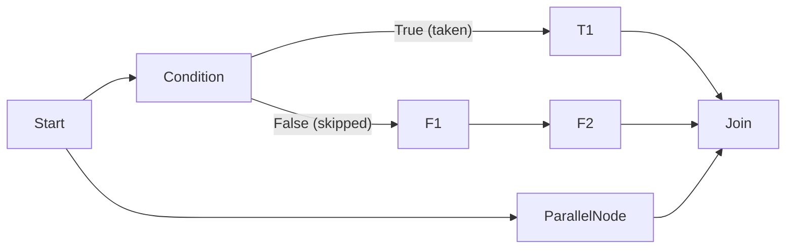
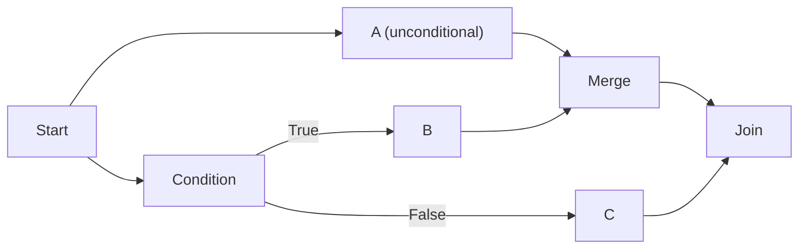
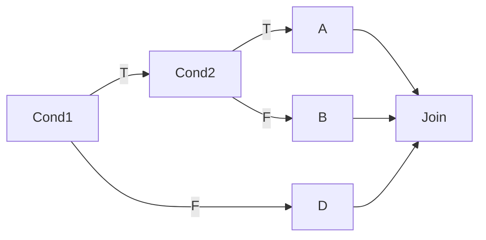

# Task 04: DAG Join Readiness, Condition Pruning, & Loop Semantics

- **Status**: Pending (Ready to implement — Decision **D2** resolved)
- **Depends On**: [03-concurrent-scheduler-loop.md](./03-concurrent-scheduler-loop.md)
- **Primary Files**:
  - `packages/server/src/utils/agentflow/dependencyEngine.ts` (new)
  - `packages/server/src/utils/agentflow/schedulerHelpers.ts`
  - `packages/server/src/utils/buildAgentflow.ts`
  - `packages/server/test/utils/buildAgentflow/dagSemantics.test.ts` (new)

---

## 1. Objective

Implement a **mathematically sound DAG dependency, conditional branch pruning, and loop re-entry engine** using **Kahn's topological scheduling + 3-state Dead-Path Elimination (DPE)** so complex graphs (nested conditions, multi-hop skipped paths, parallel forks merging with conditional branches, multi-edge fan-out per handle, and `loopAgentflow` cycles) neither deadlock nor fire join nodes prematurely.

---

## 2. Current Bugs & Failure Topologies

### Code References (`packages/server/src/utils/buildAgentflow.ts`)
- `setupNodeDependencies` (`L720-L762`)
- `findConditionParent` (`L767-L813`)
- `hasReceivedRequiredInputs` (`L818-L837`)
- `determineNodesToIgnore` (`L847-L882`)
- `processNodeOutputs` (`L887-L989`)

### Concrete Broken Graph Topologies

#### Topology A: Multi-Hop Skipped Branch Merging With Unconditional Branch

- `determineNodesToIgnore` only ignores `F1`, never marking `F2` as skipped.
- If `F2` also has a non-conditional parent or if `findConditionParent(F2)` walks a wrong edge first, `Join` classifies `F2` as an unconditional `expectedInput` and **deadlocks forever**.

#### Topology B: Multi-Parent Node Inside a Conditional Branch (`findConditionParent` Bug)

- `findConditionParent` (`L789`): `const parentEdge = edges.find((edge) => edge.target === currentId)` ONLY follows the **first** incoming edge in `edges`!
- Depending on edge array order, `findConditionParent(M)` walks `M -> A -> Start` -> returns `null` (misclassifying `M` as unconditional!) instead of discovering `Cond`.

#### Topology C: Condition Where ALL Branches Are Unfulfilled (or Multiple Outputs Fulfilled)
- What if a `conditionAgentflow` has 2 outputs (`out-0`, `out-1`), and *both* are fulfilled (or *neither* is fulfilled)?
  - If *both* are fulfilled: `hasReceivedRequiredInputs` uses `possibleSources.some(...)`, so `Join` fires as soon as the **first** branch arrives! Then when the **second** branch arrives later, `waitingNodes.get(Join)` was already deleted (`L939`), so `Join` is re-created and **executed TWICE**!
  - If *neither* is fulfilled: downstream nodes waiting on that conditional group hang silently.

#### Topology D: Nested Conditions & Diamond Joins

- `findConditionParent(A)` stops at `C2`, while `findConditionParent(D)` stops at `C1`.
- `Join` creates **two separate `conditionalGroups`**: `C2: [A, B]` and `C1: [D]`, requiring input from **BOTH** `C1` and `C2`! When `C1` takes `F -> D`, `C2` never runs, so `Join` **deadlocks forever**!

#### Topology E: `loopAgentflow` Cycles + Parallel Joins
- When `loopAgentflow` jumps back to an earlier node (`L958-L986`), any stale `waitingNodes` entries from prior iterations or branches in the loop body can corrupt subsequent loop iterations.
- Furthermore, if a loop back-edge targets a node with multiple inputs (e.g., `Start -> NodeA` AND `Loop -> NodeA`), `NodeA`'s dependency model must distinguish initial entry vs. loop re-entry.

#### Topology F: Unconnected Variable References (`{{otherNode.output.x}}`)
- `resolveVariables` (`L451-L500`) reads `agentFlowExecutedData` by `nodeId`.
- If Node B references `{{A.output.content}}` without a graph edge `A -> B`, sequential order might previously have run `A` before `B` by accident; under concurrency, `B` could run before `A`. Graph edges remain authoritative for execution ordering at runtime, and Task 08 surfaces a static validation warning in `checkFlowValidation` whenever an unlinked `{{nodeId}}` reference is detected.

---

## 3. Candidate Approaches Evaluated (Decision D2)

### Option 1: Explicit Edge-State Propagation (`PENDING | ACTIVATED | SKIPPED`) — **SELECTED**
- Track per-edge status for every edge in the graph: `PENDING`, `ACTIVATED` (source ran and activated this edge), or `SKIPPED` (source was skipped or unfulfilled this handle).
- When a decision node unfulfills an edge, mark that edge `SKIPPED` and propagate iteratively (Dead-Path Elimination).
- **Why Selected**: Handles Topologies A, B, C (0 or >1 fulfilled handles), and D (arbitrarily nested conditions) uniformly in `O(V + E)` with zero schema changes to existing flows.

### Option 2: Static Graph Pre-Analysis + Patched `conditionalGroups` *(Rejected)*
- Still brittle on nested conditions (Topology D), multi-branch fulfilled conditions (Topology C), and mixed parallel+conditional diamonds.

### Option 3: Petri-Net / Explicit Node Join-Mode Configuration *(Rejected)*
- Requires UI/schema changes for every join node and risks breaking backwards compatibility on saved Agentflows.

---

## 4. Chosen Design (`dependencyEngine.ts`)

Create `packages/server/src/utils/agentflow/dependencyEngine.ts` implementing **Kahn's Topological Scheduling + 3-State Dead-Path Elimination (DPE)** and **Longest-Path Topological Leveling**.

### 4.1 3-State Edge Propagation (`PENDING | ACTIVATED | SKIPPED`)
- **Edge Keying**: Every `IReactFlowEdge` is keyed by `edge.id || `${edge.source}:${edge.sourceHandle || ''}:${edge.target}:${edge.targetHandle || ''}`` so parallel edges or multiple condition handles between the same `(source, target)` pair are tracked independently.
- **State Structure**:
  - `edgeStatus: Map<string, 'PENDING' | 'ACTIVATED' | 'SKIPPED'>`
  - `receivedByNode: Map<string, Map<string, any>>` (stores `sourceNodeId -> outputResult` for `ACTIVATED` edges; deterministic `combineNodeInputs` joins all `ACTIVATED` inputs once ready)
  - `pendingInCount: Map<string, number>` and `activatedInCount: Map<string, number>` per node for `O(1)` Kahn countdown checks.

### 4.2 Initial Reachability Pre-Pass & HumanInput Resumption
- **Fresh Run**: Run BFS forward from `startingNodeIds` along `edges`:
  - Any node unreachable from `startingNodeIds` (e.g., disconnected canvas nodes) is pre-marked `SKIPPED`.
  - Any edge whose `source` is unreachable is pre-marked `SKIPPED`; all reachable edges start as `PENDING` (and `pendingInCount[target]` only counts `PENDING` incoming edges).
  - Result: unreachable/disconnected parent nodes never stall reachable joins.
- **Mid-Graph HumanInput Resumption (`startNodeId !== startAgentflow`)**:
  - Pre-settle edges already traversed in `agentFlowExecutedData`: for nodes present in `agentFlowExecutedData` with `status === 'FINISHED'`, mark their activated outgoing edges `ACTIVATED` (respecting recorded decision conditions if present, and marking unfulfilled handles `SKIPPED`), run DPE, and seed `receivedByNode` from `agentFlowExecutedData` so any downstream join nodes still waiting on another branch or downstream of `startNodeId` have settled incoming edges.

### 4.3 Decision Handle Pruning Fix (`edges.filter`, Not `edges.find`)
- Replace the existing bug at `buildAgentflow.ts:873` (`edges.find(...)`) with `edges.filter(...)`:
  - For decision nodes (`conditionAgentflow`, `conditionAgentAgentflow`, `humanInputAgentflow`), iterate all outgoing edges of `nodeId`.
  - Any edge whose `sourceHandle` corresponds to an **unfulfilled** condition index is marked `SKIPPED`.
  - All edges whose `sourceHandle` corresponds to a **fulfilled** condition (or all outgoing edges for non-decision nodes) are marked `ACTIVATED`.
  - **Multiple fulfilled handles (Topology C)**: Because *both* edges are marked `ACTIVATED` and `Join` waits until `pendingInCount === 0`, `Join` fires **exactly once** after both branches complete, receiving both inputs combined cleanly!
  - **Zero fulfilled handles (Topology C)**: All outgoing edges become `SKIPPED`; DPE cascades down to any downstream nodes/joins cleanly, and the flow terminates without deadlocking.

### 4.4 Kahn Readiness + Iterative Dead-Path Elimination (DPE)
When settling an outgoing edge `e: u -> v` to `newStatus` (`'ACTIVATED' | 'SKIPPED'`):
1. Use an iterative worklist queue (`settlementQueue`) to avoid recursion-depth issues on deep graphs.
2. Decrement `pendingInCount[v]`. If `newStatus === 'ACTIVATED'`, increment `activatedInCount[v]` and store `receivedByNode[v].set(u, result)`.
3. Once `pendingInCount[v] === 0` (all incoming edges to `v` have settled):
   - If `activatedInCount[v] > 0`: **Node `v` is READY** — enqueue `{ nodeId: v, data: combineNodeInputs(receivedByNode[v]), inputs: Object.fromEntries(receivedByNode[v]) }` into `nodeExecutionQueue` (sorted deterministically by tie-break comparator).
   - If `activatedInCount[v] === 0`: **Node `v` is SKIPPED** — mark every outgoing edge of `v` as `SKIPPED` and push onto `settlementQueue` to cascade DPE downstream!

### 4.5 `loopAgentflow` Subgraph Reset
- **Codebase Guarantee**: [`isValidConnectionAgentflowV2`](file:///home/loopai/work/Flowise/packages/ui/src/utils/genericHelper.js#L451-L496) (`wouldCreateCycle`) forbids cycles in ReactFlow edges, and [`Loop.ts:30`](file:///home/loopai/work/Flowise/packages/components/nodes/agentflow/Loop/Loop.ts#L30) sets `hideOutput = true`. Therefore, ReactFlow `edges` form a **strict DAG**, and the *only* cycles are explicit `loopAgentflow` jumps to `targetNodeId = result.output.nodeID`.
- **Reset Algorithm on Loop Jump** (when `loopCount < maxLoop`):
  1. Compute `loopSubgraphNodes`: BFS forward along `edges` from `targetNodeId` (stopping at or naturally covering downstream nodes reachable from `targetNodeId` within the component).
  2. For every edge `e: u -> v` where **both** `u ∈ loopSubgraphNodes` AND `v ∈ loopSubgraphNodes`:
     - Reset `edgeStatus.set(edgeKey(e), 'PENDING')`.
  3. Incoming edges into `loopSubgraphNodes` from *outside* the loop (`u ∉ loopSubgraphNodes, v ∈ loopSubgraphNodes`) remain in their settled state (`ACTIVATED` or `SKIPPED`) — preserving external inputs that already arrived before loop entry!
  4. Recompute `pendingInCount[v]` and `activatedInCount[v]` for all `v ∈ loopSubgraphNodes` from `edgeStatus`, clear stale `receivedByNode` entries for `u ∈ loopSubgraphNodes`, and enqueue `targetNodeId` (carrying `result.output` data as before).
  5. Note: if a loop body spawns concurrent branches, track active loop iteration cleanly so `loopNode` only triggers after its own predecessors settle.

### 4.6 Longest-Path Topological Leveling & Deterministic Tie-Breaking
Export pure graph analysis helpers in `dependencyEngine.ts` (reusable by Tasks 05, 06, and 08):
- `computeTopologicalLevels(nodes, edges)`:
  - Standard longest-path DP over Kahn topological order: `level(v) = max_{u -> v} (level(u) + 1)` (with `level = 0` for in-degree-0 nodes).
- `compareNodesDeterministically(a, b, levels)`:
  - Sort comparator using `(a.data?.executionOrder ?? a.position?.y ?? 0) - (b.data?.executionOrder ?? b.position?.y ?? 0)`, then `levels[a.id] - levels[b.id]`, then `a.id.localeCompare(b.id)`.
  - Guarantees 100% deterministic queue order, tie-breaking, and fallback ordering across runs while staying backwards-compatible with existing flows (which default to canvas `position.y`).

---

## 5. Implementation Steps & Verification Matrix

### Steps
1. Create `packages/server/src/utils/agentflow/dependencyEngine.ts` implementing the 3-state edge engine, reachability/resumption pre-pass, iterative DPE, `loopAgentflow` subgraph reset, `computeTopologicalLevels`, and `compareNodesDeterministically`.
2. Wire `executeAgentFlow` and `scheduler.ts` in `buildAgentflow.ts` to use `dependencyEngine.ts`, replacing `setupNodeDependencies`, `findConditionParent`, `hasReceivedRequiredInputs`, and `determineNodesToIgnore` (remove dead helpers once superseded in Task 07 or immediately if unused).
3. Implement `packages/server/test/utils/buildAgentflow/dagSemantics.test.ts`.

### Verification Matrix
- [ ] **Topology A**: Multi-hop skipped branch merging with parallel branch (no deadlock).
- [ ] **Topology B**: Multi-parent merge node inside conditional branch (edge order independent).
- [ ] **Topology C**: Condition with 0 fulfilled outputs (graceful completion via DPE) and 2 fulfilled outputs (join fires once with both inputs, not twice!).
- [ ] **Multi-edge fan-out**: Decision node handle wired to 2 target nodes properly skips/activates *both* targets (regression test for `edges.find` -> `edges.filter`).
- [ ] **Topology D**: Nested conditions (`Cond1 -> Cond2 -> [A, B]`, `Cond1 -> D`, all -> `Join`) under all 3 branch paths.
- [ ] **Topology E**: `loopAgentflow` looping over a subgraph containing parallel branches and conditions, respecting `maxLoopCount`, without clearing external settled inputs.
- [ ] Disconnected unused nodes on canvas do not block active joins.
- [ ] Human-in-the-loop resume starting mid-graph (`startNodeId !== startAgentflow`) properly settles upstream edges already completed in `agentFlowExecutedData`.
- [ ] `computeTopologicalLevels` assigns `max(parent) + 1` on diamond paths of unequal length (`A -> B -> C` and `A -> C` gives `level(C) === 2`).
- [ ] `pnpm --filter flowise build` and `pnpm --filter flowise test -- test/utils/buildAgentflow` pass.
