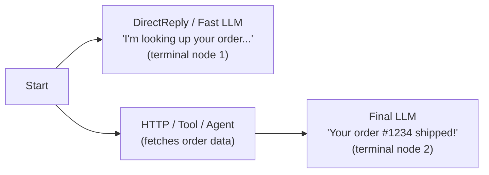

# Task 05: Multiple Terminal Nodes, Final Response Assembly, & SSE Streaming

- **Status**: Done (Decision **D4** implemented & verified)
- **Depends On**: [03-concurrent-scheduler-loop.md](./03-concurrent-scheduler-loop.md)
- **Primary Files**:
  - `packages/server/src/utils/agentflow/terminalCoordinator.ts` (new)
  - `packages/server/src/utils/buildAgentflow.ts`
  - `packages/server/src/utils/SSEStreamer.ts`
  - `packages/server/test/utils/buildAgentflow/terminalAndStreaming.test.ts` (new)

---

## 1. Objective

Design and implement consistent semantics for **multiple terminal nodes** and **SSE token streaming** under concurrent execution.

### Key Product Use Case (from User)
> *"I'd like to make it possible to run multiple terminal nodes — we need to figure out how to do it consistently (this would allow the bot to give an intermediate token stream like 'I'm looking up the data...')."*

Example target workflow:

Here, `FastReply` has out-degree 0 and completes quickly, streaming a helpful status update to the user immediately, while `SlowLookup -> FinalLLM` runs concurrently and streams the actual answer afterward!

---

## 2. Current Behavior & Code References

1. **Streaming Permission (`isLastNode`)** — `packages/server/src/utils/buildAgentflow.ts:1234-1236`:
   ```typescript
   const isLastNode =
       !isRecursive &&
       (!graph[nodeId] || graph[nodeId].length === 0 || (!humanInput && reactFlowNode.data.name === 'humanInputAgentflow'))
   ```
   - Checked by `LLM.ts:482-545`, `DirectReply.ts:43-50`, `Agent.ts`, etc.
   - **Problem**: If two terminal nodes stream tokens *at the exact same moment*, their `sseStreamer.streamTokenEvent(chatId, token)` calls interleave token-by-token (`"I'm Your look order ing #1234 up..."`).
2. **Final Content & Metadata Extraction** — `packages/server/src/utils/buildAgentflow.ts:2268-2271` & `2414-2433`:
   ```typescript
   const lastNodeOutput = agentFlowExecutedData[agentFlowExecutedData.length - 1].data?.output as ICommonObject | undefined
   let content = (lastNodeOutput?.content as string) ?? ' '
   ```
   - Also reads `sourceDocuments`, `usedTools`, `fileAnnotations`, `artifacts`, `humanInputAction` exclusively from `lastNodeOutput` (`L2414-L2433`)!
   - **Problem**:
     - If `FastReply` finishes *before* `FinalLLM`, `content` only contains `FinalLLM`'s text (discarding `FastReply`, or mismatching what was streamed to the user via SSE!).
     - Worse: if a silent side-effect terminal node (e.g., an `HTTP` analytics webhook with no `output.content`) finishes 10ms *after* `FinalLLM`, `lastNodeOutput` becomes the HTTP node and `content` becomes `' '` (blank)!
3. **SSE Streamer** — `packages/server/src/utils/SSEStreamer.ts:61-70`:
   - `streamTokenEvent(chatId, data)` writes `{ event: 'token', data }` directly to the single HTTP SSE response stream.
   - `streamAgentFlowExecutedDataEvent` buffers `client.executedFlowData` and flushes once on `removeClient` (`L28-L32`, `L162-L168`).
4. **Post-Processing & TTS** — `buildAgentflow.ts:2273-2316` & `2474-2494`:
   - Post-processing runs on `content`; auto-TTS reads `result.text`.

---

## 3. Architectural Rationale: Single Message + `\n\n` vs. Multiple Messages

We evaluated creating separate `ChatMessage` records per terminal node versus **keeping a single `ChatMessage` / single SSE stream with consecutive non-mixing sections separated by `\n\n`**:

- **Why Single Message + `\n\n` Is Significantly Simpler & Chosen (Decision D4)**:
  1. `SSEStreamer` (`packages/server/src/utils/SSEStreamer.ts:48-59`) intentionally enforces a single `client.started` guard per `chatId`, dropping subsequent `start` events.
  2. `packages/ui/src/views/chatmessage/ChatMessage.jsx:1082-1123` assumes one `apiMessage` bubble per prediction request (`start` appends one message, `token`/`sourceDocuments`/`artifacts`/`action` all mutate `updateLastMessage*`, and `metadata` pairs with the single message).
  3. `buildAgentflow.ts:2404-2470` constructs and persists a single `apiMessageId` with single `followUpPrompts`, `postProcessing`, `TTS`, `trustedData.pastChatHistory`, and `doNotIncludeFeedbackHistory` trimming; REST non-streaming mode returns one `{ text, chatMessageId }`.
  4. Emitting multiple messages would *still* require the exact same token lock/buffering layer anyway to prevent concurrent SSE token interleaving on the single HTTP response stream.

---

## 4. Chosen Design (`terminalCoordinator.ts`)

Create `packages/server/src/utils/agentflow/terminalCoordinator.ts` to coordinate per-execution SSE streaming, final response text assembly, and metadata aggregation.

### 4.1 Per-Execution `StreamCoordinator` (Consecutive Non-Mixing Streams)
Wrap `sseStreamer` for each non-recursive execution via a scoped proxy/adapter passed into `executeNode` (`runParams.sseStreamer`), keyed per launching `nodeId`:

- **Internal State**:
  - `activeStreamNodeId: string | null`
  - `pendingStreamQueue: string[]` (FIFO queue of concurrent terminal `nodeId`s waiting to stream)
  - `tokenBuffers: Map<string, string[]>` (buffered tokens/chunks per waiting node)
  - `hasEmittedContent: boolean` (true once any non-empty token output has been flushed to the wire)
  - `streamOrder: string[]` (exact chronological order in which terminal nodes acquired the stream)
- **Token Emission Rules (`streamTokenEvent(chatId, token)` & `streamStartEvent(chatId, data)`)**:
  - **Fast path (Lock free or held by `nodeId`)**: Acquire lock if `activeStreamNodeId === null` (recording `nodeId` in `streamOrder`), ensure `start` event emitted once, and forward `token` directly to underlying `sseStreamer.streamTokenEvent(chatId, token)`. Mark `hasEmittedContent = true` when non-empty.
  - **Contended path (`activeStreamNodeId !== nodeId`)**: Append `nodeId` to `pendingStreamQueue` (if not already queued) and push `token` into `tokenBuffers.get(nodeId)`.
  - **Source documents / used tools / artifacts / fileAnnotations**: Forward or record in order alongside node completion so metadata stays consistent.
- **Release & Flush (`releaseStream(nodeId)`)** (called synchronously on node completion OR error in a `finally`/commit path so a failing node never leaks the lock):
  - If `activeStreamNodeId === nodeId`:
    - While `pendingStreamQueue` has entries whose buffered tokens exist (or next in queue):
      - Pop `nextNodeId = pendingStreamQueue.shift()!`.
      - Let `buffered = tokenBuffers.get(nextNodeId) ?? []`.
      - If `buffered.length > 0` (or `nextNodeId` is still running):
        - If `hasEmittedContent` is true AND the upcoming buffered output is non-empty, emit `\n\n` once to `sseStreamer.streamTokenEvent(chatId, '\n\n')`.
        - Set `activeStreamNodeId = nextNodeId`, push to `streamOrder`, flush all `buffered` tokens to `sseStreamer.streamTokenEvent`, and clear its buffer.
        - If `nextNodeId` is still in-flight, keep lock on `nextNodeId` so its remaining tokens stream live and `break`!
        - If `nextNodeId` already finished (it completed while waiting), loop again to release its lock and advance to the next queued node!
      - If nothing remains in `pendingStreamQueue`, set `activeStreamNodeId = null`.
  - Edge case: if a second node emitted *only* empty strings `""`, do not emit a stray `\n\n` separator.

### 4.2 Final `content` Resolution (Topological Terminal Output Assembly)
Replace `agentFlowExecutedData[agentFlowExecutedData.length - 1]` (`buildAgentflow.ts:2268-2271`) with deterministic topological resolution:

1. **Identify Executed Terminal Nodes**:
   - A node is terminal if `!graph[nodeId] || graph[nodeId].length === 0`.
   - Collect all executed (`status === 'FINISHED'`) terminal nodes whose `data?.output?.content` is a non-empty string (`typeof content === 'string' && content.length > 0` — ignoring silent side-effect leaves such as `HTTP` webhooks or `CustomFunction` nodes that do not return display `content`).
   - Fallback: if executed terminal nodes exist with `output.content === ''` or `undefined`, fall back to `' '` (preserving existing empty-content fallback).
2. **Deterministic Segment Ordering**:
   - **Streaming runs**: Order content-bearing terminal nodes by `streamCoordinator.streamOrder` first (guaranteeing `ChatMessage.content` saved to DB matches the exact text order the user saw live over SSE!), with any non-streamed content-bearing leaves appended in deterministic topological/canvas order `(executionOrder ?? position.y, level, nodeId)`.
   - **Non-streaming runs**: Order content-bearing terminal nodes using `compareNodesDeterministically` from Task 04 (`executionOrder ?? position.y, level, nodeId`).
   - Join non-empty segments with `'\n\n'`.
3. **Post-Processing & TTS**: Continue running `postProcessing` and `generateTTSForResponseStream` on the assembled `content`.

### 4.3 Metadata Aggregation (`sourceDocuments`, `usedTools`, `artifacts`, `fileAnnotations`, `humanInputAction`)
Replace single-node `lastNodeOutput` lookups (`buildAgentflow.ts:2414-2433`):
- Merge array metadata (`sourceDocuments`, `usedTools`, `artifacts`, `fileAnnotations`) across executed content-bearing / terminal nodes in deterministic order (omitting empty arrays so DB columns stay `undefined` when unused, matching existing behavior).
- `humanInputAction` is handled separately by locating the `STOPPED` node record (Task 06), never via `lastNodeOutput`.

---

## 5. Implementation Steps & Verification Matrix

### Steps
1. Create `packages/server/src/utils/agentflow/terminalCoordinator.ts` implementing `createStreamCoordinator`, `resolveTerminalContent`, and `aggregateTerminalMetadata`.
2. Wire `executeAgentFlow` and `executeNode` in `packages/server/src/utils/buildAgentflow.ts`:
   - Pass node-scoped `sseStreamer` wrapper from `StreamCoordinator` into `executeNode` (only when `!isRecursive && sseStreamer`), and call `releaseStream(nodeId)` cleanly in completion/error/stop commit.
   - Replace `agentFlowExecutedData[agentFlowExecutedData.length - 1]` content/metadata lookups (`L2269`, `L2414-L2417`) with `resolveTerminalContent` and `aggregateTerminalMetadata`.
3. Implement `packages/server/test/utils/buildAgentflow/terminalAndStreaming.test.ts`.

### Verification Matrix
- [x] Fast `DirectReply` leaf + slow `LLM` leaf: fast leaf streams immediately, slow leaf buffers if overlapping and flushes with `\n\n` separator once fast leaf completes; zero interleaved tokens.
- [x] Two concurrent streaming `LLM` leaves (`A` and `B` emitting interleaved chunks `[A1, B1, A2, B2]`): wire stream equals `A1 + A2 + "\n\n" + B1 + B2`, matching saved `apiMessage.content` verbatim.
- [x] `LLM` leaf + slow silent `HTTP` webhook leaf (no `output.content`) finishing last: `result.text` retains `LLM`'s content instead of blanking out, and no trailing `\n\n` is emitted.
- [x] Empty-token edge case: node emitting only `""` does not trigger a stray `\n\n` separator.
- [x] Non-streaming (`streaming: false`): `result.text` orders multiple content-bearing leaves deterministically by `(executionOrder ?? position.y, level, nodeId)` joined by `\n\n`.
- [x] Metadata (`sourceDocuments`, `usedTools`, `artifacts`, `fileAnnotations`) aggregates across multiple terminal branches without dropping fields from earlier finishers.
- [x] Recursive subflows (`isRecursive: true` inside `iterationAgentflow`) never leak tokens to `sseStreamer` and return proper subflow `text`.
- [x] `pnpm --filter flowise build` and `pnpm --filter flowise test -- test/utils/buildAgentflow` pass.
