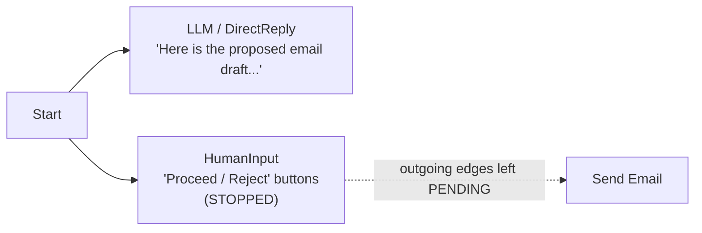

# Task 06: Error Handling & Human-in-the-Loop (`STOPPED`) Semantics

- **Status**: Done (Decision **D5** implemented & verified)
- **Depends On**: [03-concurrent-scheduler-loop.md](./03-concurrent-scheduler-loop.md)
- **Primary Files**:
  - `packages/server/src/utils/buildAgentflow.ts`
  - `packages/server/src/utils/agentflow/scheduler.ts`
  - `packages/server/src/utils/agentflow/faultCoordinator.ts` (new, optional helper)
  - `packages/server/src/utils/executionsWorker.ts`
  - `packages/server/test/utils/buildAgentflow/faultAndHumanInput.test.ts` (new)

---

## 1. Objective

Define and implement clear, simple, and predictable behavior when a concurrent branch encounters:
1. An **Error** (node throws or request is aborted via `abortController`).
2. A **Human-in-the-Loop Pause** (`humanInputAgentflow` or `agentAgentflow` with `isWaitingForHumanInput`, returning `shouldStop: true`).
3. **Execution DB Persistence** (`updateExecution` / `executionsWorker` / `trustedState`) across concurrent completions and checkpoints.

---

## 2. Current Behavior & Code References

In `packages/server/src/utils/buildAgentflow.ts`:
- **HumanInput Stop inside `executeNode`**:
  - `humanInputAgentflow` (`L1440-L1489`) and `agentAgentflow` (`L1492-L1536`):
    - Directly pushes a `STOPPED` entry to `agentFlowExecutedData`.
    - Immediately streams `nextAgentFlow` (`STOPPED`), `agentFlowExecutedData`, **`agentFlowEvent` (`STOPPED`)**, and **`action` (`humanInputAction`)**.
    - Returns `{ shouldStop: true }`.
  - Main loop (`L2105-L2108`): sets `status = 'STOPPED'` and immediately `break`s out of the loop.
- **HumanInput Resume** (`L1798-L1901`):
  - Checks `previousExecution.state === 'STOPPED'` (or `ERROR` right after `STOPPED`).
  - Auto-detects resume node by finding the **last** `STOPPED` entry (`L1852`: `[...executionData].reverse().find((data) => data.status === 'STOPPED')`).
  - Reads `humanInputAction` inside `executeNode` (`L1217-L1220`) from **`agentFlowExecutedData[agentFlowExecutedData.length - 1]`** — **BROKEN** if any sibling node finishes after the `STOPPED` node!
  - Reads `lastNodeOutput.humanInputAction` for `apiMessage.action` (`L2432-L2433`) — also **BROKEN** if a sibling finishes after the `STOPPED` node!
- **Error Handling** (`L2180-L2232`):
  - Sets `status = 'ERROR'` (or `'TERMINATED'` if aborted).
  - Appends error entry to `agentFlowExecutedData`, streams SSE error/status events, calls `updateExecution`, calls `analyticHandlers.onChainError`, and immediately `throw new Error(errorMessage)`.
- **Post-Loop Status Precedence** (`L2237-L2250`):
  - Scans `agentFlowExecutedData`: `TERMINATED > ERROR > STOPPED > FINISHED`.

---

## 3. Architectural Trade-Offs Evaluated (Decision D5)

- **Human-in-the-Loop (`STOPPED`)**: Chosen **Non-Interrupting Drain** so designers can pair an approval prompt (`humanInputAgentflow` / waiting `agentAgentflow`) on one branch with companion text or lookups on a parallel branch without prematurely killing sibling work.
- **Errors**: Chosen **Fail-Fast with Child `AbortController` behind an extensible `onNodeError` policy hook** for v1 simplicity, predictable error reporting, and preventing runaway LLM/API cost when a branch fails — while ensuring the hook cleanly supports adding an optional `'best-effort'` mode later via Task 04's Dead-Path Elimination.

---

## 4. Chosen Design (`faultCoordinator.ts` & `buildAgentflow.ts`)

### 4.1 HumanInput (`STOPPED`) — Non-Interrupting Drain

When any node returns `shouldStop: true`:
1. **Do NOT enqueue outgoing children** of the stopped node (leave its outgoing edges `PENDING` / paused) and **do NOT abort** sibling branches.
2. **Record Checkpoint Incrementally**: Mark `hasStoppedNode = true`, record its `STOPPED` `IAgentflowExecutedData` entry (including `output.humanInputAction`), and release its stream lock (Task 05) cleanly.
3. **Defer Flow-Level `STOPPED` SSE Event**:
   - Remove `sseStreamer?.streamAgentFlowEvent(chatId, 'STOPPED')` from inside `executeNode` (`buildAgentflow.ts:1484` and `L1531`)! (Keep `streamNextAgentFlowEvent(..., { status: 'STOPPED' })` and `streamActionEvent`.)
   - Emit `sseStreamer?.streamAgentFlowEvent(chatId, 'STOPPED')` **once** after all active non-blocked branches drain and execution status resolves to `'STOPPED'` (`L2262`).
   - This prevents the frontend from seeing a flow-level `STOPPED` termination event while `TextBranch` is still streaming companion text.
4. **Drain Siblings Naturally**: All remaining queued and in-flight non-blocked paths run to completion under Kahn's scheduler.
5. **Fix `humanInputAction` Lookups (`length - 1` Bugs)**:
   - Inside `executeNode` (`L1217-L1220`): instead of reading `agentFlowExecutedData[agentFlowExecutedData.length - 1]`, find the prior `STOPPED` entry matching the resumed `humanInput.startNodeId` (or latest `STOPPED` entry with `humanInputAction`).
   - At `apiMessage` persistence (`L2432-L2433`): locate `humanInputAction` from the `STOPPED` node entry in `agentFlowExecutedData` rather than `lastNodeOutput`.
   - **Multiple Concurrent `STOPPED` Nodes Rule**: Since `ChatMessage.action` (`L2433`) only holds one action object, if >1 concurrent branch stops in the same run, deterministically pick the primary action using `compareNodesDeterministically` (Task 04) and log a warning; preserve all `STOPPED` entries in `agentFlowExecutedData` so explicit `humanInput.startNodeId` resumption can still target any of them.

### 4.2 Error Policy — Fail-Fast with Child `AbortController` (Extensible Hook)
1. **Scoped Child `AbortController`**:
   - Create `const executionAbortController = new AbortController()` at the start of `executeAgentFlow`.
   - Link any caller-provided `abortController` (`signal` param) via a listener (with cleanup in `finally`) so external aborts cancel `executionAbortController`, while internal fail-fast aborts do **not** unexpectedly mutate an external caller's `AbortController`.
2. **Extensible `onNodeError` Policy Hook**:
   - Scheduler accepts `onNodeError(node, error, context): 'abort' | 'skip-branch'` (default implementation: `'abort'` / fail-fast).
   - On first node error:
     1. Record `ERROR` (or `TERMINATED` if `isAborted`) entry in `agentFlowExecutedData` and emit node-level `streamNextAgentFlowEvent`.
     2. Stop pumping new nodes from `nodeExecutionQueue`.
     3. Call `executionAbortController.abort()` so in-flight sibling LLM/HTTP calls cancel cleanly.
     4. Release stream lock for the failed node (Task 05) and **await settlement of all remaining `inFlightTasks`** before proceeding to final error persistence/throw (zero orphaned background tasks or Jest open handles!).
     5. If multiple sibling tasks reject during fail-fast teardown, preserve the **first non-abort root error** (do not let secondary `AbortError`s mask the real cause!).
     6. Update `Execution` record, update `trustedData`, emit flow-level SSE `ERROR`/`TERMINATED`, notify `analyticHandlers.onChainError`, and throw.

### 4.3 Serialized DB Persistence (`updateExecution`)
- Under `EXECUTIONS_DB_THREAD=1` (`buildAgentflow.ts:265-274`, `executionsWorker.ts`), overlapping fire-and-forget calls can execute out of order in the worker pool.
- Introduce a per-execution lightweight async promise chain (`enqueueDbUpdate(fn)`) inside `executeAgentFlow` (used by `iterationAgentflow`, finalization, and error paths) so every `updateExecution` call runs strictly in FIFO checkpoint order and is awaited before `executeAgentFlow` returns/throws.

---

## 5. Implementation Steps & Verification Matrix

### Steps
1. Implement fault/abort linking, `onNodeError` hook, and serialized `enqueueDbUpdate` helper (in `packages/server/src/utils/agentflow/faultCoordinator.ts` or integrated cleanly into `scheduler.ts` + `buildAgentflow.ts`).
2. Update `executeNode` (`L1217-L1220`, `L1484`, `L1531`) and `executeAgentFlow` (`L2105-L2108`, `L2180-L2263`, `L2432-L2433`) in `packages/server/src/utils/buildAgentflow.ts`.
3. Ensure `scheduler.ts` awaits full `inFlightTasks` settlement on error and cleans up abort event listeners in `finally`.
4. Implement `packages/server/test/utils/buildAgentflow/faultAndHumanInput.test.ts`.

### Verification Matrix
- [x] **HumanInput + Companion Text Branch**: `Start -> [DirectReply("Review this"), HumanInput("Approve?")]`: both execute, `agentFlowEvent: 'STOPPED'` emits *only after* `DirectReply` finishes, final `apiMessage` has `content: "Review this"` AND `action: humanInputAction`, execution status is `'STOPPED'`.
- [x] **Resume after parallel `STOPPED`**: Resuming with `humanInput` executes downstream of `HumanInput` without re-running `DirectReply`, and `humanInputAction` lookup inside `executeNode` succeeds even when `DirectReply` completed after `HumanInput`.
- [x] **Multiple concurrent `STOPPED` nodes**: Logs warning, selects deterministic action via topological/canvas order, and preserves both `STOPPED` records for `startNodeId` resumption.
- [x] **Fail-fast Error Cancellation**: Branch A throws while Branch B is suspended waiting on `abortSignal`; Branch B receives abort immediately, scheduler waits for Branch B to settle before throwing Branch A's original error (not masked by `AbortError`), DB status is `'ERROR'`.
- [x] **External Abort (`callerSignal.abort()`)**: Cancels all in-flight nodes cleanly, sets status `'TERMINATED'`, and cleans up listener.
- [x] **Serialized `updateExecution`**: Rapid consecutive checkpoint updates execute in strict FIFO order without earlier snapshots overwriting later ones.
- [x] **Trusted state (`useTrustedState: true`)**: Preserves consistent `previousExecution` on both `ERROR` and `STOPPED`.
- [x] `pnpm --filter flowise build` and `pnpm --filter ./packages/server test` / `pnpm --filter ./packages/server test -- test/utils/buildAgentflow` pass.
