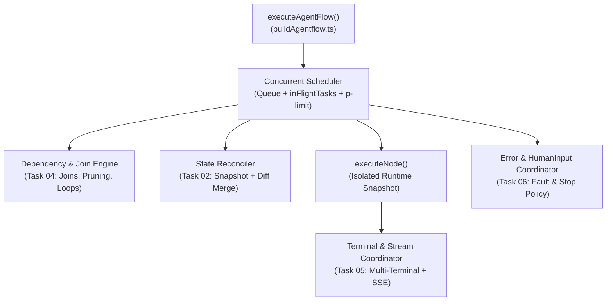
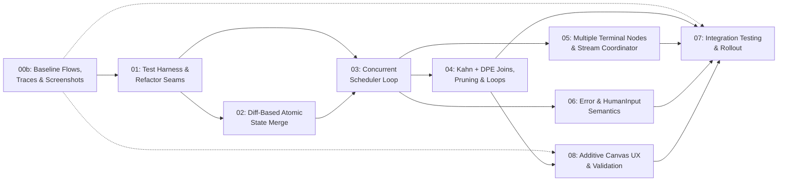

# Agentflow V2: Correct & Concurrent Node Execution — Implementation Plan

## 1. Objective

Enable **correct and concurrent node execution** in Flowise **Agentflow V2** (`packages/server/src/utils/buildAgentflow.ts`), allowing independent DAG branches to run in parallel while preserving execution correctness, runtime state integrity, streaming usability, and clean checkpoint/error semantics.

For the detailed baseline writeup of how Agentflow V2 works today, see [00-current-implementation.md](./00-current-implementation.md).

---

## 2. Decision Log

### Resolved Decisions

| ID | Topic | Decision | Rationale / Notes |
| :--- | :--- | :--- | :--- |
| **D1** | **Scope & Concurrency Bounding** | Parallelize **DAG branches** in `executeAgentFlow` using a configurable per-flow concurrency limit (`AGENTFLOW_MAX_NODE_CONCURRENCY` env var + `p-limit`). Keep `iterationAgentflow` loops sequential for now. | Keeps initial scope focused and provides `AGENTFLOW_MAX_NODE_CONCURRENCY=1` as an instant sequential fallback / regression switch. |
| **D2** | **DAG Joins, Condition Pruning, & Loops** | **Kahn's topological scheduling + 3-state Dead-Path Elimination (`PENDING \| ACTIVATED \| SKIPPED` per edge ID)**, initial BFS reachability pass, loop-body subgraph reset for `loopAgentflow`, and longest-path topological leveling with deterministic tie-breaking `(explicitOrder ?? position.y, level, nodeId)`. | Fixes multi-hop skipped branches, nested conditions, `findConditionParent` single-parent bug, 0/>1 fulfilled handles, and multi-edge fan-out in one `O(V + E)` algorithm without schema changes. |
| **D3** | **Runtime State Reconciliation** | **Diff-based atomic state merge**: snapshot `agentflowRuntime.state` before each node runs, pass an isolated runtime snapshot to `executeNode`, compute per-key deltas (added/modified/deleted) on completion, and apply deltas atomically to live `agentflowRuntime.state`. | Disjoint keys written by parallel branches never clobber each other; key deletions are respected instead of resurrected. |
| **D4** | **Multiple Terminal Nodes & SSE Token Streaming** | **Single `ChatMessage` / single SSE response** with a per-execution `StreamCoordinator` (token lock + buffer) emitting consecutive non-mixing streams separated by `\n\n`, plus topological content-bearing terminal output resolution and metadata aggregation. | Matches `SSEStreamer` (`client.started`) and `ChatMessage.jsx` (`start`/`metadata`) single-message lifecycle without breaking clients; emitting multiple messages would still require the same token buffer/lock anyway. |
| **D5** | **Error & Human-in-the-Loop (`STOPPED`) Semantics** | **HumanInput (`STOPPED`)**: non-interrupting drain — leave `STOPPED` node's outgoing edges unsettled so healthy sibling paths finish (allowing companion text alongside approval buttons). **Error**: fail-fast using a per-execution child `AbortController` behind an extensible `onNodeError` policy hook, settling all in-flight tasks before throwing; serialize `updateExecution` checkpoints. | Optimizes for simplicity and preserves companion text UX with approval buttons; leaves an extensible hook for future best-effort error tolerance. |
| **D6** | **Plan & Task Scaffolding** | Store master plan and numbered task specs under `plans/agentflow-concurrent-execution/`. | Keeps design notes and task checklists versioned alongside the codebase. |
| **D7** | **Additive Canvas UX & Concurrency Validation** | Add toggleable read-only execution wave/order badges on `AgentFlowNode.jsx` (derived client-side from longest-path leveling + `position.y` tie-break) and concurrency-aware validation checks in `packages/server/src/services/validation/index.ts`. | Makes execution waves and potential concurrency hazards visible to flow designers while remaining 100% backwards-compatible with existing saved flows. |

### Open Decisions

_All major architectural decisions (D1–D7) are resolved._

---

## 3. Target Architecture Overview

Rather than keeping all scheduling, dependency tracking, state diffing, and node execution tightly coupled inside a single 2,500-line `buildAgentflow.ts` file, we will introduce clean internal helper modules under `packages/server/src/utils/agentflow/` (or well-isolated exports) so each concern can be unit-tested deterministically with Jest:

### Key Architectural Invariants
1. **Synchronous Scheduling Commits**: All mutations to scheduler metadata (`nodeExecutionQueue`, `waitingNodes`, `inFlightTasks`, `agentFlowExecutedData`, `agentflowRuntime`) happen synchronously inside a single commit phase on node completion—zero `await`s between reading and updating scheduler structures.
2. **Isolated Node Inputs**: Each concurrent `executeNode` invocation receives a deep-cloned runtime snapshot (`state`, `chatHistory`, `form`) so in-flight nodes cannot mutate shared state directly.
3. **Deterministic Fallback**: Setting `AGENTFLOW_MAX_NODE_CONCURRENCY=1` degrades cleanly to sequential execution without a separate code path.

---

## 4. Task Breakdown & Dependency Graph

| # | Task File | Status | Design Ready? | Summary |
| :--- | :--- | :--- | :--- | :--- |
| 00 | [00-current-implementation.md](./00-current-implementation.md) | Done | N/A | Baseline technical reference of current Agentflow V2 execution. |
| 00b | [00b-baseline-flows-and-traces.md](./00b-baseline-flows-and-traces.md) | Done | Yes | Capture 6 zero-API-key local Agentflow V2 flows, `before/` SSE & `agentFlowExecutedData` traces, and canvas screenshots before any edits. |
| 01 | [01-test-harness-and-refactor-seams.md](./01-test-harness-and-refactor-seams.md) | Done | Yes | Extract testable seams & build Jest harness with controllable async mock nodes. |
| 02 | [02-diff-based-atomic-state-merge.md](./02-diff-based-atomic-state-merge.md) | Done | Yes (**D3**) | Snapshot isolation + per-key diff merge for `agentflowRuntime.state` and safe runtime commits. |
| 03 | [03-concurrent-scheduler-loop.md](./03-concurrent-scheduler-loop.md) | Done | Yes (**D1**) | Event-driven concurrent execution loop with `inFlightTasks`, `p-limit`, and sync `processNodeOutputs`. |
| 04 | [04-dag-joins-condition-pruning-and-loops.md](./04-dag-joins-condition-pruning-and-loops.md) | Done | Yes (**D2**) | Kahn's topological scheduling + 3-state Dead-Path Elimination, loop-body subgraph reset, and topological leveling. |
| 05 | [05-multiple-terminal-nodes-and-streaming.md](./05-multiple-terminal-nodes-and-streaming.md) | Done | Yes (**D4**) | Support multiple terminal nodes via per-execution `StreamCoordinator` (`\n\n` consecutive streams), topological output resolution, and metadata aggregation. |
| 06 | [06-error-handling-and-human-input-semantics.md](./06-error-handling-and-human-input-semantics.md) | Done | Yes (**D5**) | Fail-fast child `AbortController` hook on error, non-interrupting `STOPPED` drain for companion text + buttons, and serialized DB persistence. |
| 08 | [08-additive-canvas-ux-and-validation.md](./08-additive-canvas-ux-and-validation.md) | Done | Yes (**D7**) | Backwards-compatible canvas execution wave/order overlay + concurrency-aware validation checks (`validation/index.ts`). |
| 07 | [07-integration-testing-and-rollout.md](./07-integration-testing-and-rollout.md) | Pending | After 04–08 | Full end-to-end concurrency stress tests, DB/trusted-state/queue checks, `.env.example`, and rollout checklist. |

---

## 5. Verification Baseline

Canonical before/after regression suite and captured artifacts:
- **Baseline suite**: [plans/agentflow-concurrent-execution/baselines/](./baselines/) (`flows/`, `traces/before/`, `traces/after/`, `screenshots/before/`, `screenshots/after/`)

Commands used across tasks:
- **Build server**: `pnpm --filter flowise build`
- **Run server Jest tests**: `pnpm --filter flowise test`
- **Run targeted Agentflow tests**: `pnpm --filter flowise test -- test/utils/buildAgentflow`
