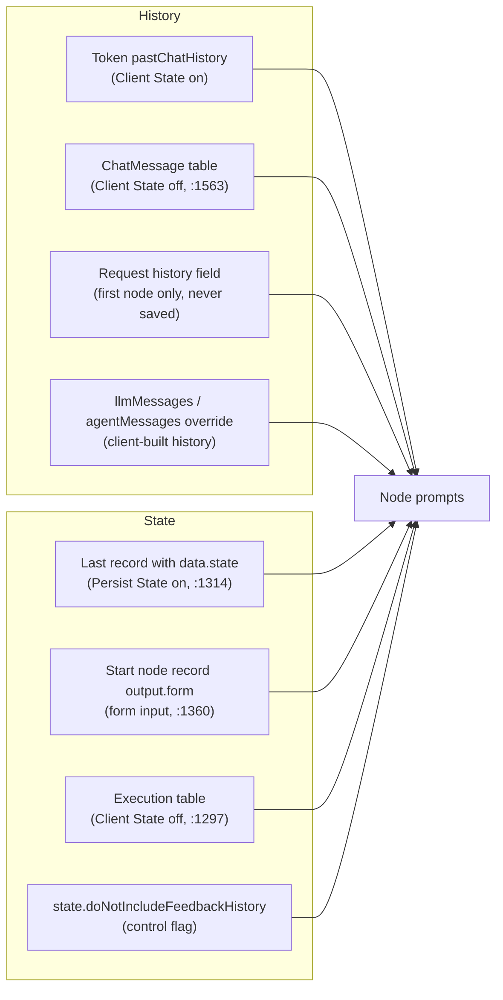

# Task 00c: Incorrect Handling to Fix (Findings)

- **Status**: Done as a list (from code reading at `d183966b`). Items marked *verify* are confirmed or dropped by the Task 00b captures and Task 01 tests.
- **Target contract** (PLAN §2, TS9–TS22): the token is the only source between turns. It holds separate fields: **history** (the single source of truth for messages), **flow state**, **form values**, **child flow tokens**, and **pending resume data** only while a turn is stopped for human input. The server never reads the DB for history, state or resume.

Line references are to `packages/server/src/utils/buildAgentflow.ts` at `d183966b` unless another file is named.

---

## Sources of history and state today

Target: one history and separate state fields, all in the token; nothing from the DB.

---

## Findings

| ID | Area | What happens today | Why it is wrong under the target contract | Fix (decision) | Task |
| :--- | :--- | :--- | :--- | :--- | :--- |
| **F01** | Server | History comes from the ChatMessage table (`:1563–1577`), the previous run from the Execution table (`lazyLoadExecution` `:1286–1310`), pending actions from ChatMessage (`:2140–2165`), and iteration parents from the Execution table (`:1503`), whenever Client State is off or env flags say so. | Two sources of truth; DB needed mid-conversation. | Token only; no DB reads (TS9). | 05 |
| **F02** | Server, Agent/LLM | The request `history` field is prepended by the first node only (`Agent.ts:1003`, LLM equivalent) and never saved. Clients also put the same history into an `llmMessages` override (`a4f69051` added de-duplication for that). | A second, unsaved history source; duplicates or loses messages depending on the client, and reaches a memory-off first node that the token history never reaches. | When the flow allows it, the client's whole conversation is the turn's history and is saved in the token; warning if the token's last message is missing (TS13, TS13a). History reaches nodes only through memory settings (TS22). | 06 |
| **F03** | Start, server | State carries over only with Persist State on, read back from "the latest record that has `data.state`" in the previous execution (`:1314–1330`). | Indirect and optional; state is half of the contract. | State lives directly in the token and always carries over; Persist State removed (TS11). | 05, 06 |
| **F04** | Start, server | Form values travel through the Start record (`:1360–1378`). The Start node then prefers the previous form over a newly submitted one (`Start.ts:208–211`), while `$form.*` variables use the new one (`incomingInput.form ?? agentflowRuntime.form`, `:754`). *verify* | Two readers disagree after a resubmission, and the values depend on a past run's record. | Form values in their own token field; a new submission replaces them (TS12, TS19). | 06 |
| **F05** | Server | In Client State mode the answer to an approval never reaches history: `doNotIncludeFeedbackHistory` is forced on (`:2152–2155`), so no user message is saved for proceed/reject/feedback. DB mode saves the feedback. | Later turns don't know what the user decided; the two modes disagree. | Save the answer as the user message (feedback text, otherwise the button label) (TS15). | 07 |
| **F06** | HumanInput, reconciler | The node's history toggle works through flow state: `state.doNotIncludeFeedbackHistory` (`HumanInput.ts:213`, `:287`) makes the reconciler cut the last history message from the token and rewrite `incomingInput.question` to the previous user message (`stateReconciler.ts` `reconcileRuntimeCommit`); it also sets `action.extra` (`:1035`) and, in DB mode, deletes the approval message (`:2159–2162`). | A control flag leaking into flow state and history surgery; three implementations of one option. | Toggle off = the approval prompt and the answer are left out of history; no state flag (TS15). | 07 |
| **F07** | Server | After a resume, history holds two bot messages in a row (the stopped turn's prompt and the resume reply) with no user message between; for an Agent tool approval the stopped turn's bot message may be empty. *verify* | Some model APIs reject empty content or non-alternating roles. | Fixed by F05 (answer saved between them); empty stopped-turn content handled explicitly. | 07 |
| **F08** | Server | The pending action is stored inside history (`apiMessage.action`, `:2233`) as JSON with the stopped node's full input, and found again by scanning history for any message with an `action` (`:2138–2165`). | Resume bookkeeping inside the history; full prompts in history. | History holds only messages; pending resume data lives in the pending field (TS-O1, TS19). | 07 |
| **F09** | Server | A resume copies the previous turn's records into the new turn (`:1464`), so the data grows across a chain of stops and resumes. | Unbounded growth while a conversation keeps stopping. | Resume data limited to what TS-O1 decides. | 07 |
| **F10** | Execute Flow | The child flow is called over HTTP with `question`, `chatId` and `overrideConfig` only (`ExecuteFlow.ts:215`); no token, and the child's state is not returned. | Without DB reads, the child has no history or state between turns. | The parent keeps the child's token in the child flow tokens field, keyed by node id, and sends it with each child call (TS16, TS19). | 05 (field), 08 |
| **F11** | Reconciler | Ephemeral memory empties both the run's history and the token history mid-run, then the current exchange is appended, so the token keeps the last exchange. | Neither "no history" nor "full history". | Nodes see no past history and the token keeps none (TS17). | 06 |
| **F12** | Server | Iteration children receive the raw token in `incomingInput` and decrypt it again per item (`:1236`), and look up the parent execution in the DB (`:1503`) even with Zero-Retention on. | Repeated decode; DB read. | Pass the decoded history and state into recursive runs; no DB lookup. | 05 |
| **F13** | Server | The token holds every node record of the turn: prompts, resolved inputs, state copy per record (00 §2–4). | Size; system prompts leave the server. | Token = history + state (+ pending resume data). | 05 |
| **F14** | Server, UI | The non-streaming response carries no token (`:2260–2271`); the Flowise UI's non-streaming path doesn't read one either. | With the token required, a non-streaming client cannot continue a conversation. | Return `trustedState` in the non-streaming JSON (and through queue mode); UI reads it. | 05 |
| **F15** | Server, UI | Paths are chosen by `chatbotConfig.clientState.enabled`, the request flag `enableTrustedState`, and `clientState.enabledFull` (`:1234–1235`); with only the request flag, Zero-Retention is undefined and executions are saved. UI toggles: "Disable recording chat history", "Disable recording Executions" (`ClientState.jsx:106`, `:117`). | Switches that select between sources. | One path. The remaining settings only control writes: recording chat messages and executions (TS9, TS21). | 05 |
| **F16** | Server | `DISABLE_CHAT_MESSAGE_RECORDING` / `DISABLE_EXECUTION_RECORDING` also change where history and the previous run are read from (`:1286`, `:1564`, `:2154`). | Env flags altering memory. | They only affect writes. | 05 |
| **F17** | UI | The internal chat keeps the token only in memory (`ChatMessage.jsx:284`); with no saved messages, reloading the page starts a new conversation. | Expected under the contract, but visible to users of the internal chat. | Document; optionally keep the token with the chat in local storage (decide in Task 09). | 09 |
| **F18** | Server | `agentFlowExecutedData` goes to every client (end of the SSE stream, non-streaming JSON, queue mode). Each record carries the node's input and output: full prompts, all resolved node settings with credential IDs, HTTP method/URL/typed headers (variables resolved) and body, Custom Function code, tool calls with results, retrieved documents, provider metadata, plus a full state copy. | External clients receive system prompts, configuration and data they don't use. | Full only for the internal Flowise chat; external clients get records pruned to status, state and the slim action (TS18). | 09 |
| **F19** | Server | The `action` payload carries the stopped node's whole input: the full conversation (HumanInput) or the full prompt plus every Agent setting with credential IDs (tool approval). | Clients use only the buttons, `data.nodeId` and the feedback flag. | Slim `action` (TS20). | 09 |

### Kept as they are (checked, not wrong)

- **Failed turns** keep the state changes of nodes that finished before the failure, and add nothing to history (TS14).
- **Uploads in history** are restored from file storage by `fileUploads` (`agentflow/utils.ts` `getPastChatHistoryImageMessages`), not from the DB.
- **Redirect to Flow** resolves the target before execution; the token passes through.
- **Memory types** on LLM/Agent/Condition Agent (all, window, summary, summary buffer) are views over the one history and stay.
