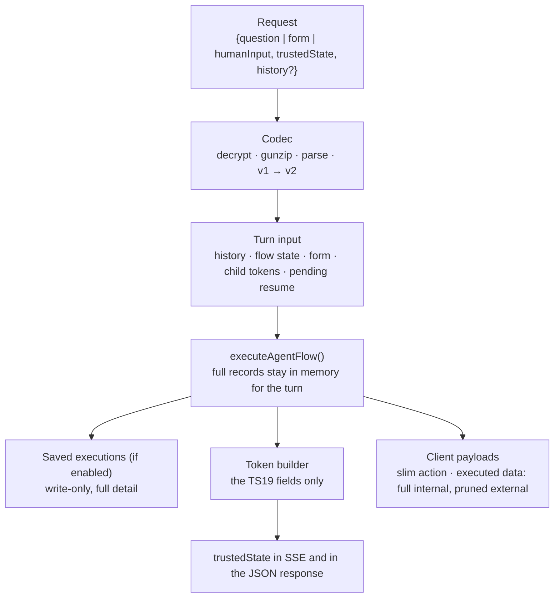
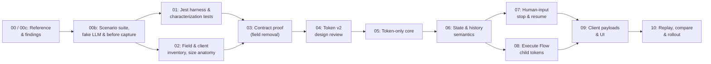

# Agentflow V2: Token-Only Conversation State — Implementation Plan

## 1. Objective

A client continues an Agentflow V2 conversation by sending the last `trustedState` token with a new question, or with its answer to an `action`. The server needs **no DB** to do it, and **history and state are correct**.

The token is the only thing carried between turns. It holds these separate fields and nothing else (TS19):
- **History**: the single source of truth for messages (user messages and bot replies).
- **Flow state**: the designer-defined state.
- **Form values**: the latest form submission.
- **Child flow tokens**: one per Execute Flow node.
- **Pending resume data**: only while a turn is stopped for human input.

Every other way of retrieving memory is removed: no ChatMessage or Execution reads, no mode switches, no records of past runs. Clients are assumed to always round-trip the token. As a result the token no longer carries system prompts or node records, and external clients no longer receive them either.

References:
- How it works today: [00-current-implementation.md](./00-current-implementation.md)
- What is handled incorrectly and must be fixed: [00c-findings.md](./00c-findings.md)
- Items raised along the way that are outside this plan: [BACKLOG.md](./BACKLOG.md)

### Non-goals
- Capping or summarising the history kept in the token (TS7).
- Changing what saved executions contain (TS5).
- Flowise message ratings (TS21).
- Agentflow V1 and chatflows (`AGENTS.md`).

---

## 2. Decision Log

### Resolved Decisions

| ID | Topic | Decision |
| :--- | :--- | :--- |
| **TS1** | Old tokens at deploy | The server reads the current (v1) and the new format and always writes the new one. A version field inside the encrypted JSON marks the format; no field means v1. Conversations and approvals paused before the deploy continue. A token paused at an Agent approval before the deploy replays its stored prompt once (D4); an unknown or broken token logs a warning and starts a new conversation (D3). |
| **TS2** | Rollback switch | No env switch for writing the old format. Rollback means redeploying; an older build cannot read new tokens. |
| **TS3** | Client payloads in scope | The `action` SSE event (and any saved `action`) and `agentFlowExecutedData` (end of the SSE stream and the non-streaming JSON) are in scope; see TS18 and TS20. |
| **TS4** | Test fixtures | Synthetic flows only, covering complex but realistic combinations. LLM/Agent nodes run against a local fake OpenAI-compatible server through the OpenAI credential Base URL. |
| **TS5** | Saved executions | When execution recording is enabled, executions are written with today's full detail, **for debugging only**. They are never read during a conversation. A resume continues the paused run's row through `updateExecution`, whose read of that row is part of recording; a missing row is tolerated (D10). |
| **TS6** | Comparison standard | Before vs. after, per scenario, turn and mode: model requests, replies, streamed tokens, node sequence, statuses and final state are identical, **except** the differences each finding intends. Those are listed in `compare.config.json` with the finding ID and the expected new behaviour. Token and payload contents are measured, not compared. |
| **TS7** | History cap | Out of scope; the size report measures the history's share. |
| **TS8** | Plan & procedure | `plans/agentflow-trusted-state/`, one task per session (§6). |
| **TS9** | Token is the only source | Agentflow V2 never reads ChatMessage or Execution rows for history, state or resume, in any mode. The Client State switch, the `enableTrustedState` request flag and the env flags no longer select sources. The remaining settings only control writes: recording chat messages (TS21) and recording executions (TS5). `clientState.enabled` and `enabledFull` stay as these write switches; the request flag only stands in for an unset `enabled` (D12). |
| **TS10** | Turn contract | Between turns only the token fields of TS19 are carried: history, flow state, form values, child flow tokens, and pending resume data while stopped. |
| **TS11** | State carry-over | Flow state always carries over. The Start node's Persist State option is removed. Start node version 1.2; a saved value is ignored (D14). |
| **TS12** | Form values | Kept in their own token field (TS19), not in flow state. A new form submission replaces them; the Start node and `$form.*` read them from there. |
| **TS13** | Request `history` field | Clients send the whole conversation in `history`, optionally starting with a welcome message. When `history` is present and allowed (TS13a), it is the turn's history instead of the token history; the turn's messages are appended and the result is saved in the token. Sanity check: if the token holds history and its last message is not in `history`, log a warning and continue. Resume turns ignore `history`, with a warning (D7). |
| **TS13a** | When client `history` is allowed | A per-flow setting, "Accept conversation history from the client", off by default. When off, `history` is ignored and a warning is logged. Flows whose clients send `history` today must turn it on at deploy. Key: `clientState.acceptClientHistory` (D12). |
| **TS14** | Failed turn | Keeps the state changes of nodes that finished before the failure (as today); adds nothing to history. A failed resume returns the incoming token unchanged, so answering again retries (D6). |
| **TS15** | Approval answers | The answer is saved as the user message of the resume turn: the feedback text, otherwise the button label (as the Flowise UI already displays it). When the HumanInput node's history toggle is off, both the approval prompt and the answer are left out of history. No control flags in flow state. Toggle off in detail: D8. A turn that ends stopped with a blank answer saves the waiting node's prompt as its bot message (D9). |
| **TS16** | Execute Flow children | The parent keeps each child's token in the child flow tokens field (TS19), keyed by node id, and sends it with each child call. |
| **TS17** | Ephemeral memory | Dropped for now: no use case (user, Task 02). The Start node option and the `startEphemeralMemory` override no longer change what nodes see; each node's own memory settings decide (TS22), and flow state carries over as usual. The option is removed from the Start node (version 1.2); a saved value is ignored, with a warning when it was on (D14). |
| **TS18** | `agentFlowExecutedData` | Sent in full only to the internal Flowise chat (`isInternal`, `/internal-prediction`), which shows executions from it. External clients get the same array with each record pruned to `nodeId`, `nodeLabel`, `status`, `previousNodeIds`, `data.name`, `data.state`, the error text, and the slim action (TS20) on stopped records. Applies to SSE, queue mode and the non-streaming JSON. |
| **TS19** | Token v2 fields | History, flow state, form values, child flow tokens and pending resume data are **separate fields** in the token; flow state is never mixed with the others. Fields `version`, `history`, `flowState`, `formValues`, `childFlowTokens`, `pendingResume` (D1); history messages keep `role`, `content`, `fileUploads` and `artifacts` (D2). Shapes: [04 §2.1–2.2](./04-decision-gate-and-token-v2-design.md). |
| **TS20** | Slim `action` | `id`, `mapping`, `elements`, `data.nodeId`, `data.nodeLabel`, `data.input.humanInputEnableFeedback`. Everything else is removed, in the SSE event and in any saved copy. |
| **TS21** | ChatMessage rows | Written only when chat message recording is enabled, and never read. Flowise ratings depend on it; not a priority this round. On resume the stop message's row is updated or deleted by its id (D11). |
| **TS22** | How history reaches nodes | Only through each node's own memory settings (on/off, all messages, window, summary), whether the history came from the token or from `history`. History holds the conversation's user messages and bot replies; output of earlier nodes reaches a node only through its own Add Messages list (user, Task 02; same-turn replies: TS25). The first node no longer prepends `history` when its memory is off. Flows that relied on that need memory turned on. |
| **TS23** | Clients | Every client that matters sends the token on every turn, approval answers included. Callers that never send it are obsolete and ignored: no compatibility work for them ([client-inventory.md](./client-inventory.md) §1). |
| **TS24** | Client memory overrides | No override is blocked: `llmEnableMemory` and the other memory overrides apply as today where the flow enables them, and `startEphemeralMemory` does nothing since TS17 (user, Task 04 D13). This replaces Task 02's block of `startEphemeralMemory` and `llmEnableMemory`: VoIP keeps its LLM nodes memory-off through `llmEnableMemory` (TS27). |
| **TS25** | Same-turn replies | A node whose reply is appended to the history adds it as an **assistant** message, and memory-on nodes that run after it in the same turn see it as part of the history. A reply that is not appended reaches later nodes only as an output variable (`{{nodeId}}`). "Return Response As: User Message", the default for Agent, LLM and Execute Flow, is removed: Assistant Message is the new default, a saved `userMessage` acts as Assistant Message and syncs to the default, and the node versions are bumped (D15). Model input changes where nodes use that default (S03 Composer, S09 Aggregator; TS6). Only the turn's final answer is saved to the token history, as today; carrying same-turn replies to later turns and streaming them is backlog B1 (user, Task 02; [client-inventory.md](./client-inventory.md) §0). |
| **TS26** | Pending resume data for an Agent tool approval | The pending field keeps the stopped Agent's tool-call message (its text, tool calls, id and usage), the history length at the stop, and the prompt messages the history does not hold (same-turn messages, a summary memory's summary, the stopped turn's uploads); never the system prompt. On resume the Agent rebuilds its prompt from the current flow, as the other nodes of a resume turn do, so values changed while paused (`{{current_date_time}}`, edited `$vars`, state changed by a branch resumed first) and flow edits made while paused take effect: an accepted change of model input (user, after Task 03: TS-O1 option (b), [03 §5.4](./03-field-removal-tests.md)). The rest of the pending data is the minimal contract in [field-inventory.md](./field-inventory.md) §6. Task 03 measured paused tokens under 1 KB, against 15–40 KB today. Refined in Task 04 (D5, user): only the Agent's own Messages list, system prompt included, is re-resolved from the current flow; the rest of the stopped prompt is stored as references into the history plus the messages the history lacks, and replayed. A token paused before the deploy replays its stored prompt once (D4). |
| **TS27** | VoIP and overrides that repeat the history | VoIP keeps sending its call in `llmMessages`, the welcome, filler words and consecutive bot messages included; the server neither merges nor reorders them, and `llmEnableMemory` keeps its LLM nodes memory-off (TS24). The tail of an `agentMessages` / `llmMessages` override that repeats the turn history is removed, with a warning, only when the node has memory on or the history came from an accepted client `history`; the rule that adds the current question runs on what remains (00b S10a t4). VoIP's `history` field is ignored with a warning while its flows keep TS13a off. `bots.intheloop.io` is Flowise itself, not the proxy. Memory-on nodes that `startEphemeralMemory` hid the token history from now see it; Task 10 checks the production VoIP and Celery flows (user, Task 04 D16; [04 §2.7](./04-decision-gate-and-token-v2-design.md)). |
| **TS28** | Concurrent and stale tokens | Last writer wins, with no detection on the server (it would need server-side conversation state, TS9). Clients send one request at a time per conversation, keep the latest token, resend the previous one to retry a failed turn, and hide approval buttons once answered; Task 10's client note documents this (user, Task 04 D17; [04 §2.12](./04-decision-gate-and-token-v2-design.md)). |

Task 04's design decisions D1–D17 are listed in [04 §4](./04-decision-gate-and-token-v2-design.md); the rows above cite the ones that refine a TS decision.

### Open Decisions

None.

---

## 3. Target Architecture Overview

### Key Invariants
1. **No DB reads for conversation data**: a conversation works with an empty ChatMessage and Execution table.
2. **One history**: every message any node sees as "past" comes from the token history.
3. **Separate fields**: everything carried between turns that is not a message lives in its own token field (TS19); flow state holds only designer-defined keys.
4. **Model input unchanged except by intent**: differences from today exist only where a finding intends them (TS6).
5. **One-way upgrade**: any v1 token is accepted at any turn, including while paused.
6. **No system prompt leaves the server** except to the internal Flowise chat: the sentinel test finds none in the token (paused tokens included, TS26), in `action`, or in executed data sent to external clients.

---

## 4. Task Breakdown & Dependency Graph

| # | Task File | Status | Parallel with | Fixes | Summary |
| :--- | :--- | :--- | :--- | :--- | :--- |
| 00 | [00-current-implementation.md](./00-current-implementation.md) | Done | — | — | How the token and payloads work today. |
| 00c | [00c-findings.md](./00c-findings.md) | Done (F04, F07 confirmed in 00b) | — | — | Incorrect handling to fix, F01–F19. |
| 00b | [00b-scenario-suite-and-baseline-capture.md](./00b-scenario-suite-and-baseline-capture.md) | Done | — | — | Fake LLM, scenarios S01–S13 (with variants), capture & compare tooling, `before/` traces. |
| 01 | [01-test-harness-and-characterization-tests.md](./01-test-harness-and-characterization-tests.md) | Done | 02 | — | Jest multi-turn harness; tests pinning today's behaviour; failing tests for the findings. |
| 02 | [02-field-inventory-and-size-anatomy.md](./02-field-inventory-and-size-anatomy.md) | Done (decisions recorded as TS17, TS22–TS25) | 01 | — | Field and client inventory (incl. `history` usage), size report. |
| 03 | [03-field-removal-tests.md](./03-field-removal-tests.md) | Done (TS-O1 resolved as TS26) | — | — | Prove that the token fields suffice for normal turns; measure and resolve TS-O1. |
| 04 | [04-decision-gate-and-token-v2-design.md](./04-decision-gate-and-token-v2-design.md) | Done (D1–D17; TS-O3 and TS-O4 resolved as TS27, TS28; TS24 amended) | — | — | Token v2 design review: field names, v1 upgrade, builder and history rules, compare entries. |
| 05 | [05-token-only-core.md](./05-token-only-core.md) | Done (interim deviations for Task 07 in 05 §4.2) | — | F01, F03, F12–F16 | v2 codec and builder, no DB reads, state in the token, token in JSON responses. |
| 06 | [06-state-and-history-semantics.md](./06-state-and-history-semantics.md) | Not started | — | F02, F03, F04, F11 | Persist State and ephemeral memory removed, form values field, client `history`, overrides that repeat the history (TS27), Return Response As (TS25). |
| 07 | [07-human-input-stop-and-resume.md](./07-human-input-stop-and-resume.md) | Not started | — | F05–F09 | Approval answers in history, no state flags, resume from slim pending data, v1 paused tokens. |
| 08 | [08-execute-flow-child-tokens.md](./08-execute-flow-child-tokens.md) | Not started | — | F10 | Child flow tokens kept in parent state. |
| 09 | [09-client-payloads-and-ui.md](./09-client-payloads-and-ui.md) | Not started | — | F17, F18, F19 | Slim `action`, executed data full internal / pruned external, UI token handling. |
| 10 | [10-replay-compare-and-rollout.md](./10-replay-compare-and-rollout.md) | Not started | — | — | `after/` capture, compare, v1 continuation, queue mode, rollout. |

08 runs after 06 although their production files are disjoint: both change the characterization tests and need a components build in the one shared checkout, and 08's version sync uses 06's `updateOutdatedNodeData` change.

---

## 5. Verification Baseline

- **Scenario suite and traces**: [baselines/](./baselines/) (`flows/`, `scenarios/`, `fake-llm/`, `traces/before/`, `traces/after/`, `reports/`).
- **Run from the repo root with `--filter ./packages/server`**, not `--filter flowise`: the root package has the same name, and its turbo run passes the test path to every package's jest, which fails in `flowise-components`.
- **Build**: `pnpm --filter flowise-components build` (when nodes change), then `pnpm --filter ./packages/server build`
- **All server tests**: `pnpm --filter ./packages/server test` (about 5 min)
- **Agentflow tests**: `pnpm --filter ./packages/server test -- test/utils/buildAgentflow`
- **Trusted state tests**: `pnpm --filter ./packages/server test -- test/utils/buildAgentflow/trustedState` (about 60 s)
- **Components tests**: `pnpm --filter flowise-components test`
- **UI build**: `pnpm --filter flowise-ui build`
- **Capture**: `node plans/agentflow-trusted-state/baselines/capture-traces.mjs --out-dir <dir>` (setup in `baselines/README.md`)
- **Compare**: `node plans/agentflow-trusted-state/baselines/compare-traces.mjs --before traces/before --after traces/after`

---

## 6. Procedure

Each task runs in its own Claude Code session, one task (or one parallel pair from §4) at a time.

1. **Read first**: this file, the task file, [00-current-implementation.md](./00-current-implementation.md) and [00c-findings.md](./00c-findings.md).
2. **Shared checkout, `master` only**: work in `/home/loopai/work/Flowise` on `master` and never switch branches. Other sessions may be editing the same checkout at the same time: touch only the task's files and leave other uncommitted changes alone.
3. **Baseline builds are isolated**: `before/` traces are built from a detached `git worktree` at a recorded commit, so uncommitted work in the shared checkout cannot leak into the baseline. No branch is created.
4. **No production edits before Task 05**: Tasks 00b–04 change only `plans/agentflow-trusted-state/**` and `packages/server/test/**`. A test seam in `src/` needs a zero-behaviour-change justification in the task file.
5. **Decisions go through the user**: anything not settled in §2 is asked in the session and recorded in §2 before it is implemented.
6. **Findings close with tests**: a fix is done when its failing test from Task 01 passes and its `compare.config.json` entry describes the new behaviour.
7. **Verify**: run the task's acceptance commands. Captures use the isolated server and fake LLM from `baselines/README.md` (ports `3100` and `3199`).
8. **Close out**: tick acceptance criteria, update status here and in the task file, and commit only the task's files to `master` (staged by path) as `docs|test|feat|fix(agentflow): trusted state task NN - 
`. Do not push.
