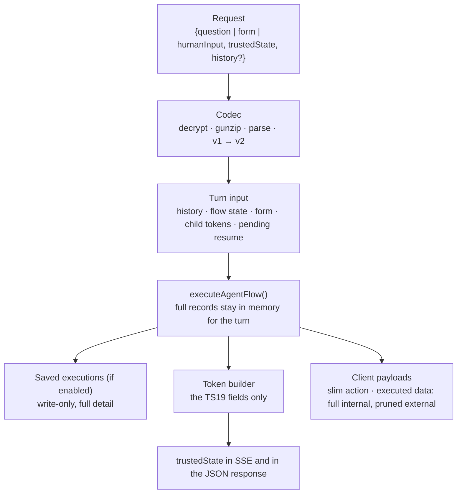
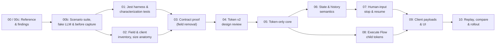

# Agentflow V2: Token-Only Conversation State — Implementation Plan

## 1. Objective

A client continues an Agentflow V2 conversation by sending the last `trustedState` token with a new question, or with its answer to an `action`. The server needs **no DB** to do it, and **history and state are correct**.

The token is the only thing carried between turns. It holds these separate fields and nothing else (TS19):
- **History**: the single source of truth for messages (user messages and bot replies).
- **Flow state**: the designer-defined state.
- **Form values**: the latest form submission.
- **Child flow tokens**: one per Execute Flow node.
- **Pending resume data**: only while a turn is stopped for human input.

Every other way of retrieving memory is removed: no ChatMessage or Execution reads, no mode switches, no records of past runs. Clients are assumed to always round-trip the token. As a result the token no longer carries system prompts or node records, and external clients no longer receive them either.

References:
- How it works today: [00-current-implementation.md](./00-current-implementation.md)
- What is handled incorrectly and must be fixed: [00c-findings.md](./00c-findings.md)

### Non-goals
- Capping or summarising the history kept in the token (TS7).
- Changing what saved executions contain (TS5).
- Flowise message ratings (TS21).
- Agentflow V1 and chatflows (`AGENTS.md`).

---

## 2. Decision Log

### Resolved Decisions

| ID | Topic | Decision |
| :--- | :--- | :--- |
| **TS1** | Old tokens at deploy | The server reads the current (v1) and the new format and always writes the new one. A version field inside the encrypted JSON marks the format; no field means v1. Conversations and approvals paused before the deploy continue. |
| **TS2** | Rollback switch | No env switch for writing the old format. Rollback means redeploying; an older build cannot read new tokens. |
| **TS3** | Client payloads in scope | The `action` SSE event (and any saved `action`) and `agentFlowExecutedData` (end of the SSE stream and the non-streaming JSON) are in scope; see TS18 and TS20. |
| **TS4** | Test fixtures | Synthetic flows only, covering complex but realistic combinations. LLM/Agent nodes run against a local fake OpenAI-compatible server through the OpenAI credential Base URL. |
| **TS5** | Saved executions | When execution recording is enabled, executions are written with today's full detail, **for debugging only**. They are never read during a conversation. |
| **TS6** | Comparison standard | Before vs. after, per scenario, turn and mode: model requests, replies, streamed tokens, node sequence, statuses and final state are identical, **except** the differences each finding intends. Those are listed in `compare.config.json` with the finding ID and the expected new behaviour. Token and payload contents are measured, not compared. |
| **TS7** | History cap | Out of scope; the size report measures the history's share. |
| **TS8** | Plan & procedure | `plans/agentflow-trusted-state/`, one task per session (§6). |
| **TS9** | Token is the only source | Agentflow V2 never reads ChatMessage or Execution rows for history, state or resume, in any mode. The Client State switch, the `enableTrustedState` request flag and the env flags no longer select sources. The remaining settings only control writes: recording chat messages (TS21) and recording executions (TS5). |
| **TS10** | Turn contract | Between turns only the token fields of TS19 are carried: history, flow state, form values, child flow tokens, and pending resume data while stopped. |
| **TS11** | State carry-over | Flow state always carries over. The Start node's Persist State option is removed. |
| **TS12** | Form values | Kept in their own token field (TS19), not in flow state. A new form submission replaces them; the Start node and `$form.*` read them from there. |
| **TS13** | Request `history` field | Clients send the whole conversation in `history`, optionally starting with a welcome message. When `history` is present and allowed (TS13a), it is the turn's history instead of the token history; the turn's messages are appended and the result is saved in the token. Sanity check: if the token holds history and its last message is not in `history`, log a warning and continue. |
| **TS13a** | When client `history` is allowed | A per-flow setting, "Accept conversation history from the client", off by default. When off, `history` is ignored and a warning is logged. Flows whose clients send `history` today must turn it on at deploy. |
| **TS14** | Failed turn | Keeps the state changes of nodes that finished before the failure (as today); adds nothing to history. |
| **TS15** | Approval answers | The answer is saved as the user message of the resume turn: the feedback text, otherwise the button label (as the Flowise UI already displays it). When the HumanInput node's history toggle is off, both the approval prompt and the answer are left out of history. No control flags in flow state. |
| **TS16** | Execute Flow children | The parent keeps each child's token in the child flow tokens field (TS19), keyed by node id, and sends it with each child call. |
| **TS17** | Ephemeral memory | Nodes see no past history and the token keeps none. Flow state still carries over. |
| **TS18** | `agentFlowExecutedData` | Sent in full only to the internal Flowise chat (`isInternal`, `/internal-prediction`), which shows executions from it. External clients get the same array with each record pruned to `nodeId`, `nodeLabel`, `status`, `previousNodeIds`, `data.name`, `data.state`, the error text, and the slim action (TS20) on stopped records. Applies to SSE, queue mode and the non-streaming JSON. |
| **TS19** | Token v2 fields | History, flow state, form values, child flow tokens and pending resume data are **separate fields** in the token; flow state is never mixed with the others. Names and shapes are set in the Task 04 design. |
| **TS20** | Slim `action` | `id`, `mapping`, `elements`, `data.nodeId`, `data.nodeLabel`, `data.input.humanInputEnableFeedback`. Everything else is removed, in the SSE event and in any saved copy. |
| **TS21** | ChatMessage rows | Written only when chat message recording is enabled, and never read. Flowise ratings depend on it; not a priority this round. |
| **TS22** | How history reaches nodes | Only through each node's memory settings, whether the history came from the token or from `history`. The first node no longer prepends `history` when its memory is off. Flows that relied on that need memory turned on. |

### Open Decisions

| ID | Topic | Direction | Resolved in |
| :--- | :--- | :--- | :--- |
| **TS-O1** | Pending resume data for an Agent tool approval | Only the needed state, not the prompt, if resumes stay correct. Kept in the pending field (TS19). | Task 03, by measurement; the user confirms if model input would change. |

---

## 3. Target Architecture Overview

### Key Invariants
1. **No DB reads for conversation data**: a conversation works with an empty ChatMessage and Execution table.
2. **One history**: every message any node sees as "past" comes from the token history.
3. **Separate fields**: everything carried between turns that is not a message lives in its own token field (TS19); flow state holds only designer-defined keys.
4. **Model input unchanged except by intent**: differences from today exist only where a finding intends them (TS6).
5. **One-way upgrade**: any v1 token is accepted at any turn, including while paused.
6. **No system prompt leaves the server** except to the internal Flowise chat: the sentinel test finds none in the token (except as TS-O1 allows while paused), in `action`, or in executed data sent to external clients.

---

## 4. Task Breakdown & Dependency Graph

| # | Task File | Status | Parallel with | Fixes | Summary |
| :--- | :--- | :--- | :--- | :--- | :--- |
| 00 | [00-current-implementation.md](./00-current-implementation.md) | Done | — | — | How the token and payloads work today. |
| 00c | [00c-findings.md](./00c-findings.md) | Done (verify items in 00b/01) | — | — | Incorrect handling to fix, F01–F17. |
| 00b | [00b-scenario-suite-and-baseline-capture.md](./00b-scenario-suite-and-baseline-capture.md) | Not started | — | — | Fake LLM, scenarios S01–S13 (with variants), capture & compare tooling, `before/` traces. |
| 01 | [01-test-harness-and-characterization-tests.md](./01-test-harness-and-characterization-tests.md) | Not started | 02 | — | Jest multi-turn harness; tests pinning today's behaviour; failing tests for the findings. |
| 02 | [02-field-inventory-and-size-anatomy.md](./02-field-inventory-and-size-anatomy.md) | Not started | 01 | — | Field and client inventory (incl. `history` usage), size report. |
| 03 | [03-field-removal-tests.md](./03-field-removal-tests.md) | Not started | — | — | Prove that the token fields suffice for normal turns; measure and resolve TS-O1. |
| 04 | [04-decision-gate-and-token-v2-design.md](./04-decision-gate-and-token-v2-design.md) | Not started | — | — | Token v2 design review: field names, v1 upgrade, builder and history rules, compare entries. |
| 05 | [05-token-only-core.md](./05-token-only-core.md) | Not started | — | F01, F03, F12–F16 | v2 codec and builder, no DB reads, state in the token, token in JSON responses. |
| 06 | [06-state-and-history-semantics.md](./06-state-and-history-semantics.md) | Not started | 08 | F02, F03, F04, F11 | Persist State removed, form in state, ephemeral memory, `history` merge. |
| 07 | [07-human-input-stop-and-resume.md](./07-human-input-stop-and-resume.md) | Not started | — | F05–F09 | Approval answers in history, no state flags, resume from slim pending data, v1 paused tokens. |
| 08 | [08-execute-flow-child-tokens.md](./08-execute-flow-child-tokens.md) | Not started | 06 | F10 | Child flow tokens kept in parent state. |
| 09 | [09-client-payloads-and-ui.md](./09-client-payloads-and-ui.md) | Not started | — | F17, F18, F19 | Slim `action`, executed data full internal / pruned external, UI token handling. |
| 10 | [10-replay-compare-and-rollout.md](./10-replay-compare-and-rollout.md) | Not started | — | — | `after/` capture, compare, v1 continuation, queue mode, rollout. |

---

## 5. Verification Baseline

- **Scenario suite and traces**: [baselines/](./baselines/) (`flows/`, `scenarios/`, `fake-llm/`, `traces/before/`, `traces/after/`, `reports/`).
- **Build server**: `pnpm --filter flowise build`
- **All server tests**: `pnpm --filter flowise test`
- **Agentflow tests**: `pnpm --filter flowise test -- test/utils/buildAgentflow`
- **Trusted state tests**: `pnpm --filter flowise test -- test/utils/buildAgentflow/trustedState`
- **Capture**: `node plans/agentflow-trusted-state/baselines/capture-traces.mjs --out-dir <dir>` (setup in `baselines/README.md`)
- **Compare**: `node plans/agentflow-trusted-state/baselines/compare-traces.mjs --before traces/before --after traces/after`

---

## 6. Procedure

Each task runs in its own Claude Code session, one task (or one parallel pair from §4) at a time.

1. **Read first**: this file, the task file, [00-current-implementation.md](./00-current-implementation.md) and [00c-findings.md](./00c-findings.md).
2. **Shared checkout, `master` only**: work in `/home/loopai/work/Flowise` on `master` and never switch branches. Other sessions may be editing the same checkout at the same time: touch only the task's files and leave other uncommitted changes alone.
3. **Baseline builds are isolated**: `before/` traces are built from a detached `git worktree` at a recorded commit, so uncommitted work in the shared checkout cannot leak into the baseline. No branch is created.
4. **No production edits before Task 05**: Tasks 00b–04 change only `plans/agentflow-trusted-state/**` and `packages/server/test/**`. A test seam in `src/` needs a zero-behaviour-change justification in the task file.
5. **Decisions go through the user**: anything not settled in §2 is asked in the session and recorded in §2 before it is implemented.
6. **Findings close with tests**: a fix is done when its failing test from Task 01 passes and its `compare.config.json` entry describes the new behaviour.
7. **Verify**: run the task's acceptance commands. Captures use the isolated server and fake LLM from `baselines/README.md` (ports `3100` and `3199`).
8. **Close out**: tick acceptance criteria, update status here and in the task file, and commit only the task's files to `master` (staged by path) as `docs|test|feat|fix(agentflow): trusted state task NN - 
`. Do not push.
